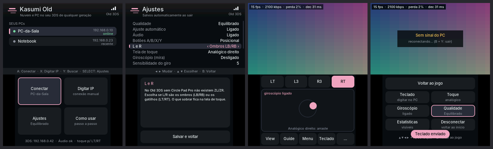
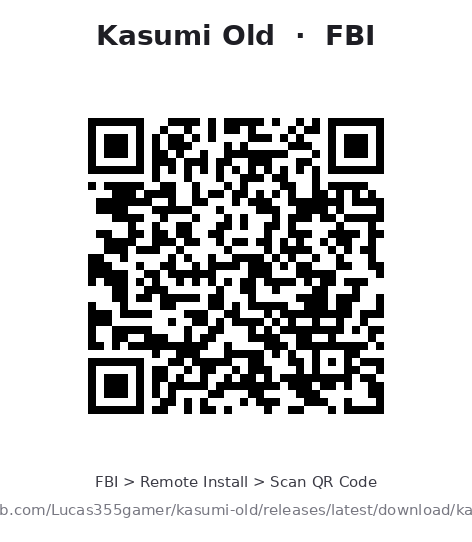

# Kasumi Old 霞

**Jogue GeForce NOW, Xbox Cloud Gaming, Steam e qualquer jogo do seu PC no Nintendo 3DS "Old"**
(3DS, 3DS XL, 2DS), e também no New 3DS.

O [Kasumi original](https://github.com/p0mpurin/Kasumi) só roda no New 3DS porque depende do
decodificador de vídeo H.264 por hardware (MVD), que o Old 3DS não tem. O ARM11 de 268 MHz do
Old 3DS também não aguenta H.264 por software. Por isso o Kasumi Old foi refeito do zero com
outra arquitetura:

```
 ┌───────────────── PC ─────────────────┐            ┌──────── 3DS (Old ou New) ────────┐
 │ GeForce NOW / Xbox Cloud / Steam ... │            │                                  │
 │            │ tela + som              │   Wi-Fi    │  JPEG 400x240 → direto no        │
 │   Kasumi Bridge (Python)             │ ─────────► │  framebuffer (libjpeg-turbo)     │
 │   • JPEG 400x240 já girado p/ o 3DS  │    UDP     │  ADPCM 24 kHz → DSP              │
 │   • áudio IMA ADPCM 24 kHz           │ ◄───────── │  botões, analógicos, giroscópio, │
 │   • controle Xbox 360 virtual        │            │  touch, teclado                  │
 └──────────────────────────────────────┘            └──────────────────────────────────┘
```



O PC faz o trabalho pesado. O 3DS só decodifica JPEG (barato), toca o som e manda os botões.
Truque principal: a ponte já envia a imagem girada 90° no layout do framebuffer do 3DS, então
cada linha do JPEG cai direto na memória de vídeo, sem cópia nem rotação.

> ⚠️ **Status:** o código do 3DS foi verificado contra as assinaturas reais da libctru e o
> protocolo foi testado de ponta a ponta no PC (veja *Testes*), mas **ainda não rodou num 3DS
> real**. Considere esta a versão 0.1: compile, teste e reporte o que acontecer.

---

## O que você precisa

| | |
|---|---|
| **Console** | Qualquer 3DS/2DS/New 3DS com CFW (Luma3DS) e Homebrew Launcher |
| **Áudio no 3DS** | `sd:/3ds/dspfirm.cdc` (gere com o app **DSP1**). Sem ele, funciona mudo |
| **PC** | Windows 10/11 (recomendado) ou Linux, com Python 3.9+ |
| **Controle virtual** | Windows: driver [ViGEmBus](https://github.com/nefarius/ViGEmBus/releases) |
| **Rede** | 3DS e PC na mesma rede. O 3DS só usa Wi-Fi de **2,4 GHz**; o PC pode estar no cabo |

## 1. Instalar no 3DS pelo FBI (QR code)



No 3DS: **FBI → Remote Install → Scan QR Code** e aponte a câmera para o QR acima.
O FBI baixa e instala o `kasumi-old.cia`, e o ícone aparece no menu HOME.

O QR aponta para
`https://github.com/Lucas355gamer/kasumi-old/releases/latest/download/kasumi-old.cia`,
que é criado automaticamente pelo GitHub Actions (`.github/workflows/build.yml`) a cada envio
de código para o repositório. Para usar outro usuário ou repositório:
`python3 tools/make_qr.py USUARIO [REPOSITORIO]`.

## 1b. Compilar você mesmo

1. Instale o [devkitPro](https://devkitpro.org/wiki/Getting_Started) e os pacotes:
   ```
   dkp-pacman -S 3ds-dev 3ds-libjpeg-turbo
   ```
2. Compile:
   ```
   cd 3ds
   make -f kasumi.mk
   ```
3. Copie `kasumi-old.3dsx` para `sd:/3ds/kasumi-old/` e abra pelo **Homebrew Launcher**,
   ou gere o `.cia` com `make -f kasumi.mk cia` (precisa de `makerom` e `bannertool`) e instale pelo FBI.

As configurações ficam em `sd:/3ds/kasumi-old/config.ini`.

## 2. Rodar a ponte no PC

**Windows:**
1. Instale o [Python](https://www.python.org/downloads/) (marque *Add python.exe to PATH*).
2. Instale o [ViGEmBus](https://github.com/nefarius/ViGEmBus/releases) e reinicie o PC.
3. Dê dois cliques em `pc/Iniciar Kasumi Bridge.bat`. Na primeira vez ele instala tudo.
4. Se o firewall perguntar, **permita em redes privadas**.

**Linux:**
```
cd pc
pip install -r requirements.txt
python3 kasumi_bridge.py --keyboard   # sem ViGEm no Linux: botões viram teclado/mouse
```

### Opções úteis
```
python kasumi_bridge.py --window "GeForce NOW"   # captura só essa janela
python kasumi_bridge.py --monitor 2              # segundo monitor
python kasumi_bridge.py --region 0,0,1280,720    # uma área da tela
python kasumi_bridge.py --stretch                # estica em vez de tarjas pretas
python kasumi_bridge.py --name "PC da Sala"      # nome que aparece no 3DS
python kasumi_bridge.py --keyboard               # teclado/mouse em vez de controle
```

## 3. Jogar

1. No PC, abra o que quiser jogar **em tela cheia**:
   - **GeForce NOW**: app ou `play.geforcenow.com` no navegador
   - **Xbox Cloud Gaming**: `xbox.com/play` no navegador
   - **Steam**: Big Picture funciona muito bem com o controle virtual
   - Emuladores e jogos nativos
2. No 3DS, abra o Kasumi Old. O PC aparece sozinho na lista. Aperte **A**.
   Se não aparecer, aperte **X** e digite o IP mostrado na janela da ponte.

## Controles

| 3DS | Vira no PC |
|---|---|
| Circle Pad | Analógico esquerdo |
| C-Stick (New 3DS / Circle Pad Pro), arrastar no toque ou giroscópio | Analógico direito |
| B / A / Y / X | A / B / X / Y do Xbox (posicional; dá para mudar para "por rótulo") |
| L / R | LB / RB, ou LT / RT (Ajustes → *L e R*) |
| ZL / ZR (New 3DS / Circle Pad Pro) | LT / RT |
| START / SELECT | Menu / View |
| Tela de toque | LT, RT, L3, R3, View, Guide, Menu, Teclado e ⋯ |
| **Segurar START + SELECT** (ou tocar em ⋯) | Menu do Kasumi: teclado, giroscópio, qualidade, estatísticas, desconectar |

- **Teclado remoto:** o que você digitar no 3DS é digitado no PC. Ótimo para logins.
- **Modo mouse:** arraste para mover o cursor; toque rápido é clique, toque longo é clique direito.
- **Fechar a tampa:** pausa. Ao abrir, reconecta sozinho.

## Qualidade e Wi-Fi

| Preset | FPS | Uso típico de rede |
|---|---|---|
| Leve | 8 | ~0,6 Mbps (Wi-Fi fraco) |
| **Equilibrado** | 12 | ~1 Mbps |
| Fluido | 15 | ~1,1 Mbps (imagem mais simples) |
| Nítido | 10 | ~1,1 Mbps (textos legíveis) |

O Wi-Fi do 3DS começa a perder pacotes perto de 1,3 Mbps, então os presets ficam abaixo disso.
Com o **ajuste automático** ligado, o 3DS manda estatísticas a cada segundo e a ponte reage:
- se a perda passa de 10%, baixa a qualidade (e depois o FPS);
- se o 3DS demora para decodificar, baixa o FPS para o que ele aguenta;
- com a rede limpa, volta a subir aos poucos, até o limite do preset.

Dicas: fique perto do roteador, use o canal 1, 6 ou 11 em 2,4 GHz, e deixe o PC no cabo.
Ative as estatísticas no menu (START + SELECT) para ver FPS, kbps, perda e tempo de decodificação.

## Problemas comuns

| Sintoma | Solução |
|---|---|
| PC não aparece na lista | Firewall do Windows: libere o Python em redes privadas (porta UDP 39770). Ou use **X** e digite o IP |
| "Sem resposta do PC" | Mesmo motivo acima. Confira se o 3DS e o PC estão na mesma rede (sem "isolamento de clientes" no roteador) |
| Sem som | Falta `sd:/3ds/dspfirm.cdc`: rode o DSP1 uma vez |
| Jogo não reconhece o controle | Instale o ViGEmBus e reinicie. Ou use `--keyboard` |
| Imagem travando | Preset Leve, chegue perto do roteador, feche downloads no PC |
| Mira do giroscópio errada | Ajustes → *Eixo do giro*, *Inverter giro vertical*, *Sensibilidade* |
| Personagem anda sozinho | Ajustes → *Zona morta do analógico* (aumente) |

## Estrutura

```
3ds/                    app do 3DS (C, libctru, libjpeg-turbo)
  source/main.c         loop principal, conexão, streaming, menus
  source/screens.c      todas as telas (portável: dá para renderizar no PC)
  source/gfx.c          renderizador 2D por software no framebuffer RGB565
  source/video.c        JPEG → framebuffer (IDCT rápida, sem dithering)
  source/audio.c        ADPCM → NDSP com pré-buffer anti-engasgo
  source/reasm.c        remontagem de quadros fragmentados (portável, testado)
  source/input.c        botões, Circle Pad Pro, C-Stick, giroscópio
  source/net.c          UDP, descoberta por broadcast
  source/protocol.h     protocolo (mesmo formato da ponte)
pc/kasumi_bridge.py     a ponte do PC
tools/genfont.py        gera as fontes (com acentos) a partir da Inter
tests/                  testes no PC (sem 3DS)
```

## Testes (no PC, sem 3DS)

```
python3 tests/test_e2e.py     # compila reasm.c/adpcm.c do 3DS e testa contra a ponte real por UDP
gcc -o tests/preview tests/preview.c 3ds/source/{gfx,screens,config,fonts}.c && mkdir -p tests/out && (cd tests && ./preview)
                              # renderiza todas as telas em tests/out/*.ppm
```

O teste de ponta a ponta confere: orientação da imagem no framebuffer, remontagem com pacotes
fora de ordem, duplicados, perdidos e atrasados, ADPCM (SNR ~28 dB), descoberta, conexão,
cerca de 14 FPS de vídeo por UDP, botões e analógicos chegando ao controle, ajuste automático
e desconexão.

## Limitações

- Precisa de um PC ligado (é o preço de rodar no Old 3DS).
- A latência estimada fica em torno de 100 a 200 ms (captura, JPEG, Wi-Fi e decodificação). Funciona bem
  para RPG, estratégia, plataforma e jogos de turno; é pesado para tiro competitivo.
- Sem 3D estereoscópico e sem modo 800 px.

## Créditos e licença

- Inspirado no [Kasumi](https://github.com/p0mpurin/Kasumi) de p0mpurin. Este é um projeto
  independente, escrito do zero, e não é afiliado ao Kasumi, à NVIDIA, à Microsoft, à Valve
  nem à Nintendo.
- Fonte [Inter](https://rsms.me/inter/) (SIL Open Font License), convertida por `tools/genfont.py`.
- [libjpeg-turbo](https://libjpeg-turbo.org/), [libctru](https://github.com/devkitPro/libctru),
  [ViGEmBus](https://github.com/nefarius/ViGEmBus) / [vgamepad](https://github.com/yannbouteiller/vgamepad),
  [mss](https://github.com/BoboTiG/python-mss), [SoundCard](https://github.com/bastibe/SoundCard),
  [pynput](https://github.com/moses-palmer/pynput).
- Licença: GPL-3.0 (a mesma do Kasumi original).
